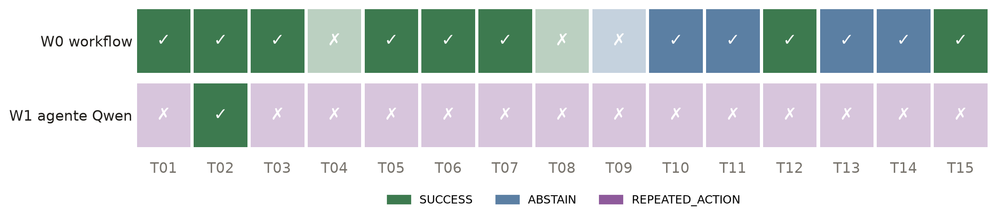

# CC0F4 · PC3 — De sistemas RAG evaluables a workflows, agentes controlados y memoria verificable

**Pedro Lautaro Quispe Ballesteros** · CC0F4 Tópicos de Ciencia de la Computación I (2026-2) · Semanas 9 y 10 (con reutilización de las semanas 4, 6 y 7) · modalidad individual.
Commit evaluado: `71fc880` (`71fc88041868f680e24ba382adef857abc458904`, repositorio `lautaroballesteros0926/PC1_Topicos1`, rama `main`).

Tema de investigación (el mismo de la PC1, la PC2 y el parcial): *Sistema multiagente con RAG híbrido para la detección temprana de riesgo de mercado con alertas sustentadas en evidencia*.
Todo el análisis está en [`notebook/PC3_workflows_agentes_memoria.ipynb`](notebook/PC3_workflows_agentes_memoria.ipynb), que ya trae las salidas guardadas.

## 1. Problema y continuidad

| Entrega | Qué dejó | Qué usa la PC3 |
|---|---|---|
| PC1 (`../README.md`) | Qwen2.5-0.5B no aplica la regla de riesgo; el cálculo debe ir a código. | La regla y los CSV de precios, a través de la herramienta del parcial. |
| PC2 (`../pc2/`) | Recuperación densa e5 + FAISS. | El encoder e5 y `IndexFlatIP` también sirven para la memoria semántica (M3). |
| Parcial (`../parcial/`) | Corpus de 21 documentos y 150 passages, qrels, recuperador **C** (e5 + BM25 + RRF + Cross-Encoder), `risk.compute_signal` con contratos y Qwen con decoding greedy. | Se **importan** desde `../parcial/src` (`src/config.py`) sin copiarlos ni modificarlos. El baseline del parcial queda intacto. |

El parcial evaluó por separado la recuperación, la generación y la herramienta. La PC3 estudia lo que ese pipeline no resuelve: **coordinar varias operaciones con control de errores y de terminación**, y **conservar información entre ejecuciones sin confundir recuerdos con hechos actuales**.

## 2. Tarea multi-paso

```text
pregunta + (activo, fecha)
-> search_evidence: evidencia del episodio (recuperador C)
-> compute_signal: señal de riesgo low / medium / high (regla de la PC1)
-> contraste: ¿la severidad justifica una alerta y hay evidencia del evento?
-> finish {decision: alert | no_alert | abstain, ticker, as_of, severity, evidence_ids, memory_ids}
```

## 3. Arquitectura: workflow y agente

Las dos políticas corren sobre **el mismo controlador** (`src/controller.py::run_task`, ciclo Perceive → Decide → Act → Observe). Solo cambia quién propone la siguiente acción.

| | W0 workflow (`src/workflow.py`) | W1 agente (`src/agent.py`) |
|---|---|---|
| Siguiente acción | Plan fijo: buscar con la pregunta → `compute_signal` de cada par pedido → `finish` | Qwen2.5-0.5B devuelve un JSON `{action, arguments, reason}` |
| Terminación | Al acabar el plan | La decide el LLM (`finish`) |
| Respuesta | Regla: severidad ≥ medium → `alert`; low → `no_alert`; error de la herramienta → `abstain`; evidencia = los 3 primeros passages | La redacta el LLM; el controlador la valida |
| Tokens | 0 | Se cuentan los de cada decisión |

Qué decide el **controlador** en ambos casos: la allowlist y el contrato de cada acción, los presupuestos, el timeout, la detección de acciones repetidas y de falta de progreso, la validación de cada observación antes de que entre al contexto y la validación del `finish`. Este último se acepta solo si la severidad coincide con una señal observada (o con un recuerdo citado) y los `evidence_ids` fueron vistos. El modelo **nunca** ejecuta herramientas ni comandos. ReAct acotado: el campo `reason` (≤ 20 palabras) queda en la traza, intercalado con la acción y la observación.

## 4. Herramientas, contratos y controlador

| Herramienta | Origen | Contrato |
|---|---|---|
| `search_evidence(query, top_k≤5)` | Recuperador C del parcial (`retrieval.run_condition`) | `SearchArgs`; observación `SearchObs` (≤ 6 passages, texto truncado a 220 caracteres, ids comprobados contra el corpus) |
| `compute_signal(ticker, as_of)` | `tool_risk.call_tool` del parcial (Exp. 3) | `SignalArgs` + los contratos del parcial (dominio, reintento solo para `transient`/`timeout`, deadline de 2 s) |
| `read_passage(passage_id)` | **Nueva** (auxiliar) | Solo para passages ya vistos; texto ≤ 650 caracteres |

Los errores llegan al modelo **solo como campos** (`ErrorObs`: `kind`, `code`, `retryable`, `attempts`), sin el mensaje libre: un fallo no se convierte en instrucción.

**Límites** (`src/config.py::Limits`, escritos en `results/declared_config.json` antes de la primera corrida evaluada, junto con los hashes del benchmark, los prompts, el corpus y los precios):

| `max_steps` | `max_tool_calls` | `timeout_per_tool` | `total_deadline` | `max_input_tokens` | `max_output_tokens` | otros |
|---|---|---|---|---|---|---|
| 6 | 5 | 20 s (+ 2 s internos de la herramienta de riesgo) | 300 s | 2 048 por decisión (memoria ≤ 450 y ≤ 3 recuerdos) | 200 (= parcial) | `max_invalid_outputs` 2, `max_tool_errors` 2, `no_progress_patience` 2 |

**`stop_reason`** (definiciones exactas en `config.STOP_REASONS`): `SUCCESS` (finish aceptado con alert/no_alert) · `ABSTAIN` (finish aceptado con abstain) · `MAX_STEPS` (pasos o llamadas agotados) · `TIMEOUT` (deadline total o timeout de la herramienta) · `TOOL_ERROR` (2 errores de herramienta seguidos) · `INVALID_OUTPUT` (2 decisiones inválidas: JSON, acción, argumentos o finish no sustentado) · `NO_PROGRESS` (2 acciones seguidas sin información nueva) · `REPEATED_ACTION` (misma acción y argumentos ya ejecutados).

## 5. Modelo y configuración

`Qwen/Qwen2.5-0.5B-Instruct` (revisión `7ae5576…`, la del parcial, cargado con `parcial/src/llm.py`): CPU, float32, greedy, `repetition_penalty=1.05`, `max_new_tokens=200`. No se usa ninguna API ni ninguna biblioteca de agentes: el controlador y la memoria son Python, JSONL y FAISS. Prompts en `prompts/`: el prompt se ajustó en 3 versiones **solo** con 2 tareas de desarrollo que no están en el benchmark (`data/dev_tasks.jsonl`; cada versión y sus trazas en `results/dev/v1..v3`). La v3 se congeló antes de las corridas evaluadas.

## 6. Benchmark de tareas y criterios de éxito

`data/tasks.jsonl` + `data/expected_results.jsonl` (15 tareas), generadas por `src/build_tasks.py`. Las respuestas esperadas **no salen de las corridas**: la severidad se calcula con la regla de la PC1 (la misma que reproduce sus 8 casos gold) y la evidencia aceptable es el conjunto de passages del corpus que describen cada episodio, anotado leyendo su texto (`data/evidence_sets.json`; T08 usa los qrels de Q01 del parcial).

| Tipo | Tareas | Qué exigen |
|---|---|---|
| Ordinarias (8) | T01–T05 alerta en COVID, SVB, carry trade, 2022 y aranceles; T06 periodo tranquilo; T07 comparar SPY e IWM; T08 citar el récord del VIX | Buscar + calcular + contrastar (T07: dos señales) |
| Fallo de herramienta (4) | T09 fecha no hábil (error **real**); T10 fuente caída, T11 salida corrupta, T12 fallo transitorio que se recupera (**inyectados**) | Recuperarse o abstenerse sin inventar |
| Abstención o rechazo (3) | T13 ETF peruano sin datos; T14 fecha de 2008 fuera de rango; T15 afirmación falsa de un colega | No emitir una conclusión sin sustento |

**Éxito:** `alert` → coinciden decisión, ticker, fecha y severidad, y al menos un `evidence_id` está en la evidencia aceptable. `no_alert` → coinciden decisión, ticker, fecha y severidad low. Abstención → no se emite conclusión y el `stop_reason` es `ABSTAIN` o `TOOL_ERROR`. `termination_correct` = el `stop_reason` está entre los permitidos de la tarea.

## 7. Experimento 1 — Workflow determinista frente a agente controlado

**Pregunta:** ¿elegir herramientas y el siguiente paso con un LLM aumenta el éxito respecto de un workflow fijo? **Hipótesis:** con 0.5B, no; podría ayudar donde el plan fijo no se adapta (T08, T09). **Fijo:** benchmark, corpus, recuperador, herramientas, controlador, límites, modelo y decoding, sin memoria. **Variable:** la política. Ejecuciones: 1 por tarea (greedy, determinista).

| | task_success | termination_correct | pasos | llamadas | errores de herramienta | acciones repetidas | latencia media | tokens (entrada / salida) |
|---|---|---|---|---|---|---|---|---|
| **W0 workflow** | **0,80** (12/15) | 0,93 | 3,07 | 2,07 | 5 | 0 | 1,8 s | 0 / 0 |
| **W1 agente Qwen** | 0,07 (1/15) | 0,07 | 2,87 | 1,87 | 4 | 14 | 38,3 s | 43 218 / 2 077 (≈ 3 020 por tarea; contexto máx. 1 545) |

Ejecución local: no hay costo monetario, solo tokens y tiempo. Progreso parcial: W1 observó la señal esperada en 8/11 tareas (W0 en 10/11) y vio evidencia del episodio en 7/9 (W0 en 8/9). Le falta decidir que ya terminó.



**Análisis (trazas en `results/traces/exp1/`).**
- **W1 mejora un paso: T04.** W0 busca con la pregunta completa y cita `D17-P03, D17-P04, D03-P04` (SVB), así que falla la evidencia. W1 reformula la consulta y recupera `D02-P01…P04` (mercado de 2022), pero lee dos veces el mismo passage y se detiene por `REPEATED_ACTION`. Mejora la recuperación, no el resultado.
- **W1 no mejora y cuesta más: T09.** W0 recibe el error real `date_not_trading_day` y se abstiene (falla de forma segura). W1 repite la misma búsqueda y nunca pide la señal (25,7 s y 1 984 tokens). Una rama del workflow ante ese código resolvería T09 sin LLM.
- **Único éxito de W1: T02**, ~28 veces más lento que W0. **T08:** W0 cita la definición del VIX en lugar del récord; W1 inventa el id `P01-01` y el contrato lo rechaza.

**Conclusión:** para esta tarea un workflow fijo basta (0,80 frente a 0,07; ~21 veces menos latencia; cero tokens). Lo que un agente podría añadir (reparar fechas, reformular la búsqueda) se obtiene con *routing* dentro del workflow. No se generaliza a modelos mayores, que no se probaron.

## 8. Experimento 2 — Estado y memoria

**Pregunta:** ¿qué mejora aporta cada memoria a tareas encadenadas y qué errores introduce? **Fijo:** el agente W1 (modelo, prompt, decoding), herramientas, controlador, límites, presupuesto de contexto (2 048, con ≤ 450 tokens y ≤ 3 recuerdos de memoria) y orden de las interacciones. Cada condición empieza con los almacenes vacíos. Las sesiones se simulan reiniciando la working memory y releyendo del disco los almacenes persistentes.

| | Qué guarda | Recuperación | Persistencia | Invalidación |
|---|---|---|---|---|
| Estado de ejecución (todas) | Contadores y observaciones de **una** tarea (`RunState`) | — | No | — |
| **M0** | Nada | — | — | — |
| **M1** working | Resultado de las tareas anteriores de la **sesión** | Las 3 más recientes | Se borra al cambiar de sesión | — |
| **M2** episódica | Un episodio por tarea: tarea, acciones, observaciones validadas, resultado, errores (`episodic.jsonl`) | Relevancia léxica + recencia + importancia (Park et al.) | Sí | No (es historia) |
| **M3** semántica | Un hecho por señal de cada tarea con `SUCCESS`, con procedencia (herramienta, hash de precios, passages), versión y estado (`semantic.jsonl`) | e5 + FAISS sobre hechos **activos** | Sí | Una señal más reciente del mismo activo (≤ 120 días) marca la anterior `superseded` |

Escribe el **controlador**, solo con campos validados (sin prompts, salidas crudas ni el `rationale` del modelo). Cada operación queda en `memory_ops.jsonl`; el borrado está implementado y probado.
**Secuencias** (`data/memory_scenarios.jsonl`, 9 interacciones, 7 sesiones): S1 (SVB) recuperación en la misma sesión y desde otra; S2 (carry trade) **actualización controlada del escenario**: la fecha avanza al 30-ago-2024 con precios reales y la alerta *medium* del 5-ago queda obsoleta; S3 interferencia entre dos alertas *high* de SPY (COVID y aranceles).
**Denominadores:** `memory_recall_accuracy` / 4 que necesitan memoria (éxito **y** cita del recuerdo correcto); `cross_session_retention` / 3; `stale_memory_error_rate` / 2; `wrong_memory_use_rate` / interacciones con algún recuerdo citado. Un acierto sin citar el recuerdo correcto no cuenta como recuperación.

**Resultados con el agente Qwen (experimento oficial, `results/exp2/`):**

| | task_success | memory_recall | cross_session | stale_error | wrong_memory_use | recuerdo correcto mostrado (@3) | tokens de contexto / de memoria | latencia |
|---|---|---|---|---|---|---|---|---|
| M0 | 0,22 | 0 | 0 | 0 | — | 0/4 | 1 164 / 0 | 39,9 s |
| M1 | 0,11 | 0 | 0 | 0 | — | 1/4 | 1 104 / 23 | 35,7 s |
| M2 | 0,11 | 0 | 0 | 0 | — | 4/4 | 1 183 / 205 | 34,4 s |
| M3 | 0,11 | 0 | 0 | 0 | — | 2/4 | 1 188 / 137 | 44,7 s |

El modelo **nunca** citó un recuerdo. El 0,22 de M0 incluye **un acierto por casualidad** (S1-2): sin memoria, usó la fecha 2023-03-13, que es la del ejemplo del prompt. En S3-3 repite esa fecha ante una pregunta sobre el COVID y falla.
**Casos (trazas en `results/traces/exp2/`).** *Ayuda a un paso:* en S1-3 y S2-3, con M2, el agente toma la fecha del recuerdo mejor rankeado (2023-03-13; 2024-08-30, la vigente) y recalcula la señal correcta. Sin memoria no tiene la fecha y se repite; con memoria tampoco termina. *No mejora:* en S1-2 con M1 y M2 pone el id del recuerdo en `evidence_ids`; el controlador lo rechaza dos veces (`INVALID_OUTPUT`). *Información equivocada:* en S3-3 con M2, el episodio de aranceles (E008, más reciente) queda primero y el agente calcula 2025-04-08 para una pregunta sobre el COVID (interferencia). M3 quedó casi vacía (solo consolida tareas con `SUCCESS`) y sirvió su único hecho, de SVB, en todas las preguntas.

**Diagnóstico sin LLM (añadido después de ver la corrida con Qwen; no reemplaza al experimento oficial).** Mismas interacciones, controlador y almacenes, con `MemoryReaderWorkflow`: plan de W0 si hay activo y fecha; si no, responde con el **primer** recuerdo mostrado que menciona el activo (`results/exp2/diagnostic_reader/`).

| | task_success | memory_recall | cross_session | stale_error | wrong_memory_use |
|---|---|---|---|---|---|
| M0 | 0,56 | 0 | 0 | 0 | — |
| M1 | 0,67 | 0,25 | 0 | 0 | 0 |
| M2 | 0,78 | 0,50 | 0,33 | **0,50** | 0,33 |
| M3 | **1,00** | **1,00** | **1,00** | 0 | 0 |

En S2-3, M2 responde con el recuerdo **obsoleto**: la alerta *medium* del 5-ago (puntaje 2,40) queda delante de la señal *low* del 30-ago (2,25), porque la importancia pesa más que la recencia. M3 acierta porque el hecho viejo quedó `superseded` y ya no se sirve.

## 9. Pruebas de robustez y terminación

| Caso | Dónde | Resultado |
|---|---|---|
| Error transitorio | T12 (se recupera: `attempts=2`), T10 y R5 (no se recupera) | Alerta correcta en T12; `ABSTAIN` (W0) y `TOOL_ERROR` (R5) sin respuesta |
| Salida inválida | T11 (precios corruptos) | `output_contract`: nunca llega a ser una «señal»; W0 se abstiene |
| Acción repetida | R1 y 14 tareas de W1 | `REPEATED_ACTION` |
| Pasos agotados | R2 | `MAX_STEPS` (`max_tool_calls`) |
| Evidencia insuficiente | T13, T14 | W0 `ABSTAIN`; W1 no emite respuesta |
| Recuerdo obsoleto | S2-3 | M2 lo usa (lector); M3 lo invalida |
| Otros | R3 texto no JSON, R4 finish con evidencia o severidad no observadas, R6 sin progreso, R7 timeout | `INVALID_OUTPUT`, `INVALID_OUTPUT`, `NO_PROGRESS`, `TIMEOUT` |

Las pruebas R1–R7 son **guionizadas** (no son un LLM) y usan las herramientas reales: 7/7 con el `stop_reason` esperado y ninguna respuesta emitida (`results/exp1/robustness.csv`). Además hay **20 pruebas unitarias** (`tests/`).

## 10. Resultados comparativos

| Experimento | Variable | Resultado | Error analizado | Conclusión |
|---|---|---|---|---|
| 1 | W0 → W1 | 0,80 → 0,07 de éxito; 1,8 s → 38,3 s; 0 → ≈ 3 020 tokens por tarea | T04, T09, T02, T08 | Un workflow fijo basta; el agente 0.5B no sabe terminar |
| 2 (agente) | M0 → M1 → M2 → M3 | 0,22 / 0,11 / 0,11 / 0,11; recall 0 en todas | S1-2, S1-3, S2-3, S3-3 | La memoria guía algún paso, pero el modelo no la usa para responder |
| 2 (lector) | M0 → M3 sin LLM | 0,56 / 0,67 / 0,78 / 1,00 | S2-3 obsoleto en M2 | La memoria semántica con invalidación es la única sin errores |

## 11. Análisis de trazas y errores

Cada paso de cada corrida guarda `task_id, step, selected_tool, arguments, reason, decision_status, observation_status, state_updated, tokens, context_tokens, memory_tokens, latency_ms, raw_output, stop_reason`. En el Exp. 2 se guardan además los recuerdos mostrados (id, tipo, estado, versión, procedencia y puntaje) y los escritos. Patrones de W1: (1) **repetir la acción anterior** tras recibir una observación válida (14/15); (2) **meter campos de más** en los argumentos (DEV1 v2: `severity` dentro de `compute_signal`; M3 S1-3: `reason` dentro de `arguments`), que el contrato rechaza; (3) **inventar ids** (`P01-01` en T08); (4) **confundir campos** (id del recuerdo en `evidence_ids`); (5) **copiar el ejemplo del prompt** (fecha 2023-03-13). En las 51 corridas del agente no salió ninguna alerta con severidad inventada ni con evidencia no observada. Sí salió una respuesta válida en forma pero a otra pregunta: M0 S3-3, la alerta de SVB ante una pregunta sobre el COVID. El controlador verifica que lo dicho esté sustentado, no que responda a lo que se preguntó.

## 12. Limitaciones

Un solo LLM (0.5B, CPU). 15 tareas y 9 interacciones: resultados descriptivos, sin significancia estadística. Benchmark y evidencia anotados por el autor. El prompt se ajustó con 2 tareas de desarrollo; el ejemplo del prompt sesgó la fecha elegida. Parar ante la primera repetición es estricto y explica buena parte del 1/15; no se probó una política más tolerante para no cambiar los límites tras ver los resultados. Las fallas inyectadas son controladas, no de red real; el timeout de la búsqueda es cooperativo. El lector determinista y las métricas `gold_retrieved_*` son posteriores a la corrida con Qwen (declarado). La memoria procedimental es solo el prompt fijo y no se evaluó. Las marcas de tiempo `*_utc` de la corrida del Exp. 1 vienen del reloj del contenedor, que estaba desfasado unas 5 horas respecto del Exp. 2. No afecta a los resultados.

## 13. Fuentes y trazabilidad

| Sem. | Recurso | Concepto | Archivo / función | Evidencia | Limitación propia |
|---|---|---|---|---|---|
| **9** | `Semana9/Lectura9-CC-0F4.md` (§2, §3, §5, §6, §8, §10), `Semana9/Cuaderno9-CC-0F4.ipynb` (§13, §16, §18), `Semana9/agent_loop.py` | Workflow frente a agente, ReAct, controlador con allowlist, presupuestos, repetición, validación del finish | `controller.py::run_task`, `check_finish`; `workflow.py`; `agent.py`; `run_exp1.py` | W0 12/15, W1 1/15; 14 `REPEATED_ACTION`; 7/7 pruebas de robustez | Un modelo; deadline cooperativo; parada estricta |
| **10** | Enunciado PC3 §2 (contenidos de la Semana 10); Park et al.; Packer et al. | Estado ≠ memoria; working, episódica y semántica; persistencia, versión, invalidación y borrado | `memory.py`; `run_exp2.py`; `tests/test_memory_eval.py` | Agente: recall 0; lector: 0,56 → 1,00; stale 0,5 en M2 y 0 en M3 | Procedimental no evaluada; 9 interacciones |
| 4 | `Semana4/Cuaderno4-CC-0F4.ipynb` | Encoder e5 + FAISS | `SemanticStore` | Hechos de M3 indexados | Sin umbral de similitud |
| 6 | `Semana6/Cuaderno6-CC-0F4.ipynb`, parcial Exp. 3 | Contratos, errores como datos, reintento y timeout | `tools.py`; `tool_risk.call_tool` | T11, T12, R7 | Timeout cooperativo en la búsqueda |
| 7 | `Semana7/Cuaderno7-CC-0F4.ipynb`, parcial Exp. 1 | Métricas con denominador y análisis de errores | `evaluation.py` | `per_task.csv`, `per_interaction.csv` | Sin pruebas estadísticas |

**Fuentes técnicas.**
1. Yao, S., et al. (2023). *ReAct: Synergizing Reasoning and Acting in Language Models.* ICLR. arXiv:2210.03629. Fundamenta el campo `reason` intercalado con la acción y la observación, y la traza paso a paso.
2. Anthropic (2024). *Building Effective Agents.* Fundamenta la distinción entre workflow y agente, la recomendación de empezar por la solución más simple (W0 como baseline) y el *routing* como alternativa a la autonomía.
3. Park, J. S., et al. (2023). *Generative Agents: Interactive Simulacra of Human Behavior.* arXiv:2304.03442. Fundamenta la recuperación episódica por relevancia, recencia e importancia normalizadas (M2).
4. Packer, C., et al. (2023). *MemGPT: Towards LLMs as Operating Systems.* arXiv:2310.08560. Fundamenta la separación entre un contexto acotado (presupuesto de tokens de memoria) y un almacenamiento externo persistente que se consulta (M2 y M3).
5. Kapoor, S., et al. (2024). *AI Agents That Matter.* arXiv:2407.01502 (citado en la Lectura 9). Fundamenta comparar agentes contra baselines simples y reportar el costo junto con la exactitud.
6. Shinn, N., et al. (2023). *Reflexion.* arXiv:2303.11366. Referencia de memoria episódica verbal; no se implementó (el modelo no reflexiona sobre sus fallos).

**Dominio.** Board of Governors of the Federal Reserve System, *Financial Stability Report* (mayo de 2020 y abril de 2025), y BIS Bulletin No 90 (*The market turbulence and carry trade unwind of August 2024*), documentos D18, D19 y D20 del corpus. Fundamentan los episodios y la evidencia aceptable de T01, T03, T05 y S2. La regla de severidad es la de la PC1.

**Herramientas.** Python 3.12, Docker, FAISS, sentence-transformers, transformers, Pydantic y pytest. La escritura del código y de los textos contó con apoyo de un asistente de IA (Claude Code). Los resultados salen de las corridas guardadas en `results/`.

## 14. Reproducción

Requisitos: Docker Desktop abierto. La PC3 usa **la misma imagen que el parcial** (`build: ../parcial`) y monta el repositorio completo, porque importa `../parcial/src`. Los modelos están en el volumen `pc1_hf`, compartido con las entregas anteriores.

```bash
cd pc3
docker compose up                      # Jupyter en http://localhost:8891/lab
```

| Qué | Comando (`docker compose run --rm pc3 …`) | Tiempo aprox. (CPU) |
|---|---|---|
| Pruebas (20) | `python -m pytest tests -q` | 6 s |
| Benchmark | `python src/build_tasks.py` | 1 s |
| Exp. 1 (W0 + W1 + robustez) | `python src/run_exp1.py` | 11 min |
| Exp. 2 (agente) | `python src/run_exp2.py` | 23 min |
| Exp. 2 (diagnóstico sin LLM) | `python src/run_exp2.py --policy reader` | 1 min |
| Figuras y cuaderno | `python src/make_figures.py && python src/make_notebook.py && jupyter nbconvert --to notebook --execute --inplace notebook/PC3_workflows_agentes_memoria.ipynb` | 1 min |
| Demostración para la defensa | `python src/demo.py` (W0 y W1 sobre T09, memoria M3 y recuerdo obsoleto) | 1–2 min |

```text
pc3/
├── README.md  requirements.txt (= parcial)  docker-compose.yml
├── notebook/PC3_workflows_agentes_memoria.ipynb
├── src/   config.py  tools.py  controller.py  workflow.py  agent.py  memory.py  evaluation.py
│          build_tasks.py  run_dev.py  run_exp1.py  run_exp2.py  demo.py  make_figures.py  make_notebook.py  notebook_text.py
├── data/  tasks.jsonl  expected_results.jsonl  memory_scenarios.jsonl  dev_tasks.jsonl  evidence_sets.json
├── prompts/ agent_system.txt  agent_user.txt
├── results/ declared_config.json  dev/  exp1/  exp2/ (memory_store/, diagnostic_reader/)  traces/ (exp1, exp2, exp2_reader)
├── tests/ test_controller.py  test_memory_eval.py
└── slides/PC3_CC0F4.pdf  fig/
```
